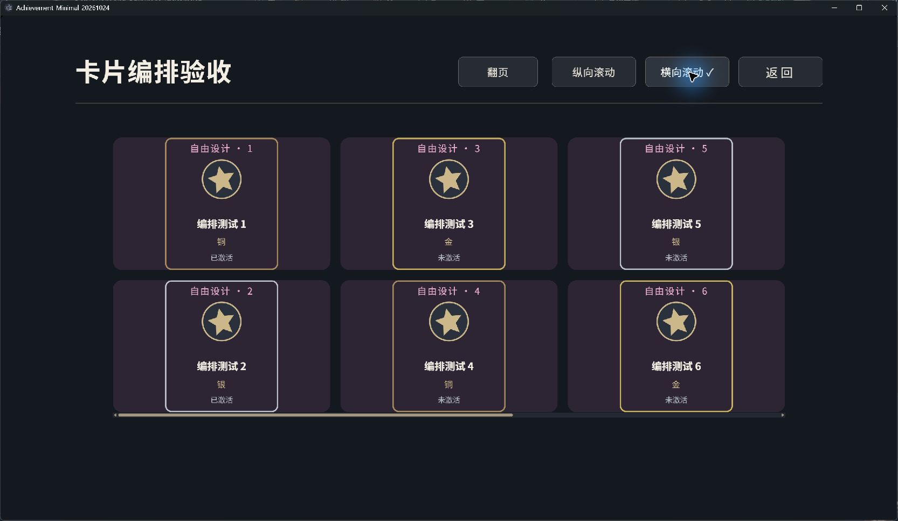

# 局内成就系统

**0.2.0 适用于 LetsGal Studio 3.0 正式版。** 创作者可以给成就分组，为等级、卡片和浮现分别选择组默认值，并开放玩家筛选。展示阶段可编排为互斥的同层分支，或向更高层推进。每个阶段都可以选填 Steamworks API Name，剧情继续用「成就操作」。

提供官方手动编排与尺寸参考、独立的通用卡片／浮现方案、等级外观关联，以及阶段背景、线框／九宫格、元素动效与逐元素进阶 CSS。卡片展示与阶段浮现分开配置内容、外观和元素 CSS，各自排版在官方编辑器设计。通过剧情预览测量实际单卡空间并显示建议宽高；官方编辑画布尺寸自动同步尚未接入。

为 LetsGal 游戏提供可配置等级、图标与名称、可选说明、自定义展示阶段、成就页和浮现通知。当前阶段是唯一状态：默认隐藏、未激活、已激活三个普通预设，创作者可修改或新增阶段；卡片和浮现跟随当前阶段。默认提供金银铜边框；默认翻页／滚动统一在官方 UI 编辑器设置；扩展补充横纵方向与玩家额外可选方式。三种方式共用一份可视化卡片模板，默认固定翻页、不显示切换按钮。页面、卡片和浮现界面均可设计；卡片与浮现默认使用本阶段说明，也可分别填写，浮现说明控件可隐藏、删除或自由排版；列表容器的高级 CSS 由浏览模块管理。

开发环境为 Studio 3.0.0。编译完整源码前，在 Studio 的扩展开发面板执行“同步 SDK”，再运行 npm ci 和 npm run build。游戏创作者可直接导入已构建的插件包。

Studio 3.0.0 已加载六个方法。Windows x64 Player 已验证分组筛选、同层保留、快读与冷启动读旧普通档。Steam 的同层、跳层、读档和失败处理已通过模拟接口验证，真实账号解锁待作品 App ID 实机验收。

创作者在扩展配置页管理成就；阶段及浏览、浮现偏好按玩家跨档保存。

创作工作台分为“成就”“属性配置”“界面与浮现”：搜索对象后在固定编辑区修改，阶段内容、卡片和浮现各有入口；默认阶段与通用方案可复用，也可按成就覆盖。

从成就旁“查看关联图”查看阶段关系：完整沿用时连接默认阶段，有单独配置时连接卡片、等级、浮现；通用配置和界面按需展开。初始呈放射布局，节点拖动带弹性牵引，Ctrl＋滚轮缩放；双击节点定位编辑，返回后保留图的位置和视角。官方界面节点提供编排路径。

输入停止约半秒后校验提交，选择和开关立即提交。无效草稿留在本次工作台，外部冲突先核对；顶部显示提交、未保存或拒绝状态。对象与排序项保留右键删除、可见按钮和原有保护。

剧情可使用“成就操作”“读取成就信息”“打开成就页”“刷新成就界面数据”“设置分组可见性”和“浮现方式”。创作者可在设置页开放连续或合并浮现。展示阶段可指定不同等级，卡片和浮现同步更新。

## 下载与使用

升级前先备份工程和玩家数据。0.2.0 自动将玩家阶段保存到官方扩展共享存档，并沿用已有的 stageProgress 记录。仅存于旧数据集合的进度需要另行迁移，请保留原表并在工程副本中验证。

从 [Release](https://github.com/recurse00-stack/letsgal-achievement/releases/tag/v0.2.0) 下载 `mixing-entropy.achievement-0.2.0.zip`，在 Studio 中导入扩展并加入项目。需要源码、手册和 AI 指南时下载 `letsgal-achievement-0.2.0-bundle.zip`。

[中文使用说明](docs/USER-GUIDE.md) 包含工作台配置、共享阶段记录、剧情切换阶段、编辑卡片、浏览方式及浮现动画。解压完整包后，也可以离线打开 `docs/USER-GUIDE.html`。

## AI 辅助与源码

[成就 AI 指南](ai/SKILL.md) 随完整包提供。运行 `python tools/install-ai.py` 预览 Skill 与离线手册的安装位置，确认目标后添加 `--apply`。更新已有不同内容时加 `--upgrade`，安装器先备份并核验；个人补充文件不会自动删除。需要 LetsGal 通用创作指导时，另从 [LetsGal Authoring Kit](https://github.com/recurse00-stack/letsgal-authoring-kit/releases) 获取主 Skill。

构建源码时先在 Studio 中同步官方 SDK 和 Studio UI Kit，再在 mixing-entropy.achievement 中执行 npm install、npm run check、npm run build、npm test。SDK 和 UI Kit 使用宿主提供的版本，不自行替换接口。运行代码和编辑期代码分别构建到 dist/index.mjs 与 dist/studio.js。

“界面与浮现”分为“成就页”“卡片”“浮现”。“卡片”中的卡片表现方案、“浮现”中的单条浮现方案可建立多套并指定各自默认。阶段沿用方案，需要时展开独立内容、外观或浮现时长；恢复沿用后继续跟随更新。卡片排版仍使用成就页的官方模板。
