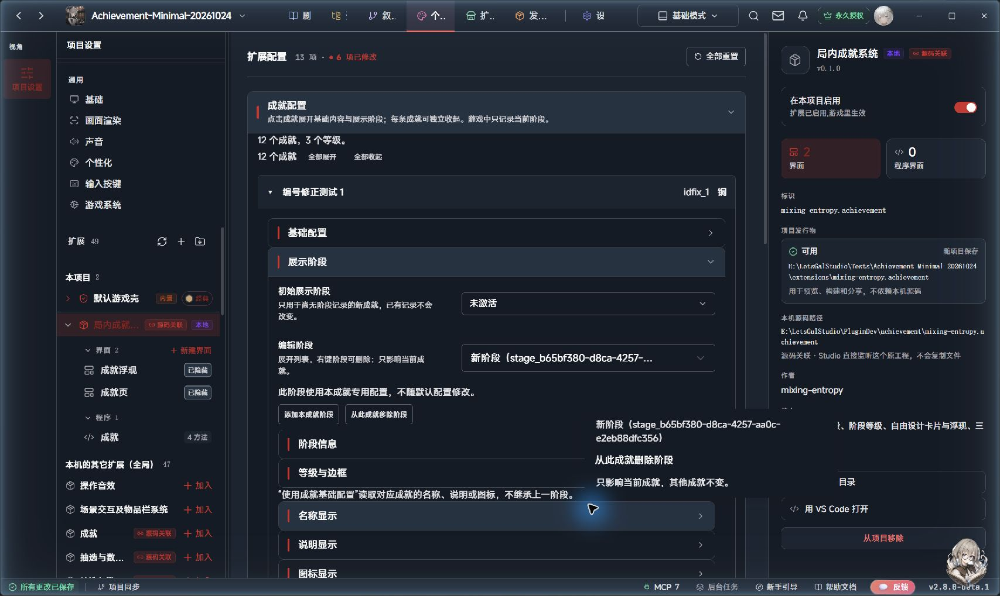
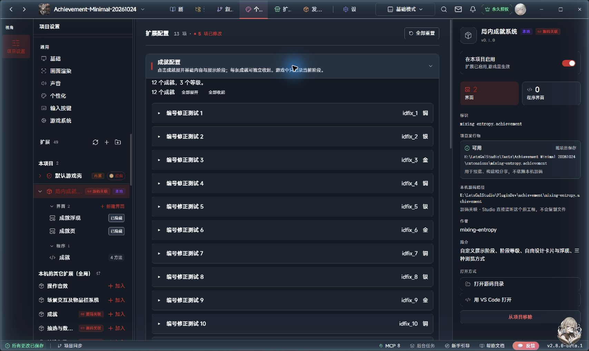
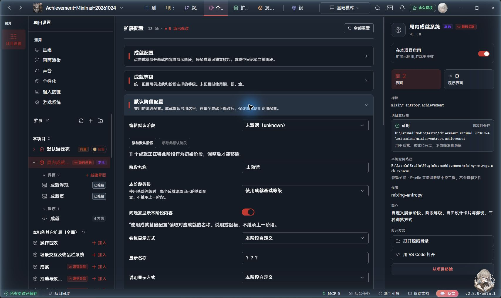
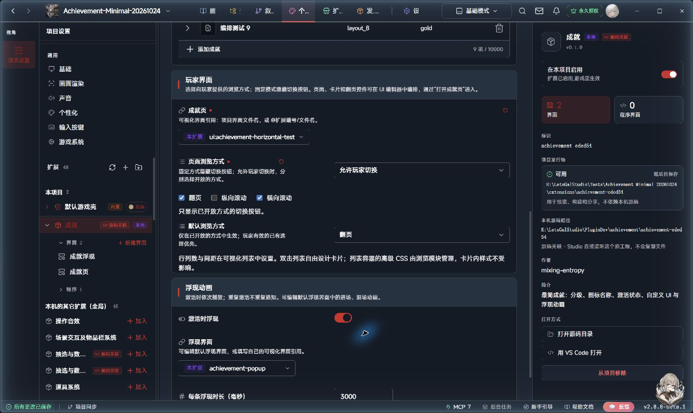
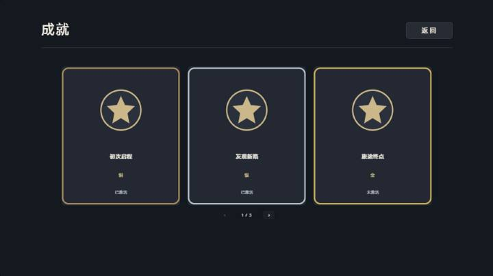
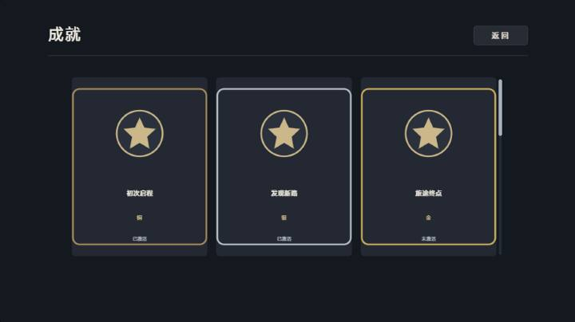
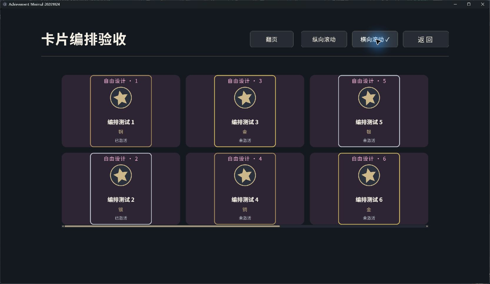
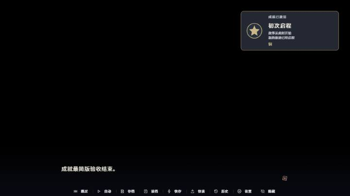

# 局内成就系统使用说明

版本 0.1.2，发行修订 20261029-release.1。适用 LetsGal Studio 2.8.0-beta.1。本版采用展示阶段模型，不兼容 0.1.0 的激活方法与记录格式；升级前请备份工程，再按“数据、存档和更新”重新接入。

## 这个版本能做什么

每个成就只有一个当前展示阶段。默认提供“隐藏”“未激活”“已激活”，它们都是普通预设名称；创作者可以改名、修改内容或添加中间阶段。没有额外的“是否激活”开关，也不会根据铜银金推断达成历史或自动升级。

成就提供编号、基础名称、说明、图标和等级；阶段决定当前显示内容、是否入库、使用哪个等级。卡片和浮现跟随同一阶段。成就页支持翻页、纵向滚动和横向滚动；创作者选择固定方式或开放哪些方式给玩家。默认提供铜银金边框，页面、卡片和浮现均可设计。

定义与阶段配置保存在扩展结构化设置，当前阶段记录保存在官方 profile 数据表。自动写官方作者表、自定义属性组、成就资料 Wiki、鉴赏、进度、分组系列、奖励助力和限时挑战仍未提供。条件、监听与宏由外部系统决定，本插件不增加条件编辑器。

## 离线手册与 AI 资料

本页是插件的使用手册，提供目录跳转、关键词筛选和浏览器打印，可直接打开 USER-GUIDE.html，无需启动网站或连接网络。“成就资料 Wiki”指计划中的作品资料查阅／备注功能，与本手册不同。

完整资料包同时包含插件、离线手册和 AI Skill。运行 `python tools/install-ai.py` 先查看安装位置，加 `--apply` 安装两份资料；已有不同内容时，再加 `--upgrade` 明确更新，原文件会先保全。插件主体仍在 Studio 中导入，不由资料安装器修改。

本机已有 letsgal-authoring 时，Skill和手册分别位于用户目录下 `.letsgal-authoring/plugins/mixing-entropy.achievement/0.1.2/SKILL.md` 和同目录的 `docs/USER-GUIDE.html`。主技能通过插件索引读取Skill；人工使用直接打开手册。没有主技能时，安装器放入所选AI的独立插件Skill目录，路径以预览结果为准。

本资料对应 0.1.2；使用旧版插件时请读取对应版本的手册与 Skill。

## 安装和启用

1. 在 Studio 的个性化面板导入 mixing-entropy.achievement 文件夹。使用成品选复制导入，持续开发选关联源码工程。
2. 将“局内成就系统”加入项目并启用。
3. 在数据表面板为“成就展示阶段记录”依赖使用新版模板创建并绑定。契约 letsgal.achievement.states 2.0.0，保存范围 profile，初始表为空。必需字段只有 achievementId、stageId，均为文本；行 id 由宿主生成。
4. 打开“剧本 → 扩展 → 局内成就系统”的独立配置页，添加成就并设置其展示阶段。

旧 1.x 记录表不能直接绑定新版。没有需要保留的测试数据时，可保留旧表作备份，再从新版模板创建空表并绑定。需要保留既有阶段时，先备份工程与存档，原位更新表契约和 schema，保留表编号与 profile 范围；本版不提供自动迁移工具。仅删除表格中的 active 列不会解除旧 schema 的必填约束。

## 配置界面分层

| 顶层入口 | 配置什么 |
| --- | --- |
| 成就管理 | 每个成就的基础配置、阶段信息、本阶段内容与阶段表现 |
| 通用配置 | 成就等级、默认阶段配置、通用卡片展示、通用浮现 |
| 界面与播放 | 成就页与卡片编排、浏览权限、全局浮现播放开关 |

在“成就管理 → 对应成就 → 展示阶段”选中阶段，展开“阶段表现”，里面并列“卡片展示”和“阶段浮现”。两处可分别折叠、修改或恢复默认。名称、说明、图标默认使用“本阶段内容”；单独填写只影响所在的卡片或浮现，不继承上一阶段。

在“通用配置 → 通用卡片展示／通用浮现”分别建立可复用方案；每组可有多套，选择一套作为默认。方案保存显示规则、背景、边框、动效和元素 CSS；浮现方案还保存界面与时长。具体名称、说明和图标读取当前阶段，不在方案里再填一份。卡片内部排版仍使用成就页中的官方模板，方案不创建另一张卡片画布。

阶段里默认显示沿用来源与简要摘要。“本阶段内容”每项先显示当前值，需要修改时点“单独设置”；卡片／浮现默认也不展开另一套内容编辑框。选择“单独设置内容”后才填写差异，“恢复沿用内容”重新使用当前阶段内容和方案显示规则，不影响另一处表现。

阶段的“表现方案”可选“沿用本组默认方案”“选择通用方案”“跟随本阶段等级”或“完全单独配置”。引用方案后，点击“单独调整外观或 CSS”，只开启要改的背景、边框或动效；关闭该项覆盖即可恢复跟随。普通参数按分段覆盖，CSS 仍按属性覆盖。

浮现就近显示当前生效的界面和时长；需要不同设置时点“单独设置界面与时长”。优先使用阶段专用值，其次所选通用浮现方案；方案未设置时使用官方浮现默认值。官方默认值只在“通用浮现”选择“使用官方界面原样”时显示编辑入口。“界面与播放”只保留总播放开关；排队由模块处理，不需要另写宏。

排队中的成就如果已离开目标阶段，该通知跳过；正在播放时切到其他阶段会结束原浮现，新通知按新阶段设置排队。只改配置、打开成就页、读档恢复和重复设置同一阶段都不会新发通知。

## 从隐藏到提示，再到完整展示

1. 在“新成就编号”填 first_step，点击“添加成就”，展开“基础配置”，填写：名称“初次启程”，说明“故事从此时开始”，等级 bronze，图标选择作品图片。
2. 展开“初次启程”，在它下方的“展示阶段”里，把初始展示阶段设为“隐藏”。新玩家的成就库没有这张卡片。
3. 点击“添加本成就阶段”，在“阶段信息”中名称填“获得线索”。展开“本阶段内容”，分别点击名称与说明旁的“单独设置”，选择“本阶段自定义”，分别填“远方的邀请”“去车站看看吧”。在“阶段表现 → 卡片展示”选择“显示卡片”；需要提示时，在旁边的“阶段浮现”开启“进入此阶段时浮现”。
4. 获得线索的剧情中添加“成就操作”：先选“初次启程”，目标阶段选“获得线索”。需要提示玩家时勾选“切换时浮现”。卡片和浮现均显示线索内容。
5. 事件完成后再添加同一方法，目标选择“已激活（revealed）”。默认显示基础名称、说明、图标与等级；不需要再执行一次激活。
6. 若后期需要升级，新增例如“大师”阶段并给它指定 gold 等级，剧情直接切到该阶段。系统只保存当前阶段，不额外记一套激活事实或自动补齐低等级记录。

阶段编号稳定，改名不会改变编号。方法块可下拉选择成就和阶段，也可按编号或变量指定。需要限制跳转时，展开“仅在此阶段执行”，指定预期当前阶段；不符则整项跳过。目标必须存在，不按列表顺序自动“加一”。

阶段下拉框跟随所选成就，只列出它实际拥有的阶段，不混入其他成就的自定义阶段。初始默认提供隐藏、未激活、已激活三个共用阶段；修改默认配置或为此成就移除阶段后，选项跟随实际配置。已移除或不属于该成就的旧阶段编号只在旁边提示，不作为选项；请重新选择，系统不会擅自改写原参数。使用变量指定成就时，编辑器无法提前确定运行时取值，仍按阶段编号或变量填写。

## 成就列表与默认阶段配置

“成就管理”区域和每条成就都能折叠。条目默认收起，只显示名称、编号和等级；点击标题展开后，基础名称、说明、图标、等级以及展示阶段都在这条成就内配置。上方提供“全部展开／全部收起”，新添加的成就自动展开。折叠只改变编辑器显示，不影响玩家状态。

基础配置、展示阶段、阶段信息、阶段等级、本阶段内容和阶段表现可折叠；名称、说明与图标先显示摘要，点“单独设置”才展开编辑项。展开／收起不保存新配置，也不改变继承关系。通用配置与界面与播放同样可折叠。

展开“编辑阶段”下拉列表，右键要移除的阶段，选择“从此成就删除阶段”。操作只影响右键点中的阶段和当前成就，不要求先选中它。右键菜单贴着目标阶段显示，列表保持展开；删除后可继续操作剩余阶段。按 Esc 先关闭菜单，点击外部收起列表。选项以浅边框分隔，删除项下方的小字说明作用范围。

“编辑默认阶段”列表同样支持右键“删除默认阶段”，影响沿用它的成就，已建立的专用配置保留。初始阶段和最后一个可用阶段会禁用删除并说明原因。原有移除按钮继续可用。

新成就编号可以自填，也可留空自动生成。创建后编号固定用于剧情引用；修改名称不会改编号。成就等级放在独立的可折叠区域中统一维护。

“默认阶段配置”是共用设置，初始提供下表三个阶段。这里修改阶段名称、显示内容或等级，会影响仍沿用它的成就；添加默认阶段后，各成就都可使用。每个阶段使用“成就基础配置”时，分别读取所属成就自己的名称、说明、图标或等级。

阶段信息、等级与本阶段内容一起沿用默认阶段；在成就内修改它们后，成为该成就的专用内容，使用“恢复阶段信息与内容”可恢复。卡片展示与阶段浮现各自保存，改其中一项不会把另一项变成专用配置；各自的“恢复本项默认配置（含 CSS）”只恢复本项。“添加本成就阶段”只增加该成就可选的阶段。

“从此成就移除阶段”只让当前成就不再使用它，方法下拉框也不再列出；其他成就仍可使用。被移除的默认阶段可通过“恢复已移除的默认阶段”找回。如果希望一个阶段完全不对玩家显现，在“卡片展示”选择“不生成卡片”，并关闭“阶段浮现”。该阶段仍可被方法切换，与移除阶段不同。隐藏预设已提供这种组合。

“移除此默认阶段”会从共用配置中移除该阶段，已经建立完整专用配置的成就仍保留自己的版本。当前作为初始阶段的选项须先更换初始阶段，最后一个可用阶段不能直接移除。默认配置为空时使用内置三个预设，不表示禁用所有阶段。

## 配置展示阶段

| 默认预设 | 编号 | 默认表现 |
| --- | --- | --- |
| 隐藏 | hidden | 没有卡片、不浮现 |
| 未激活 | unknown | 问号名称、问号说明、未知图标、中性边框 |
| 已激活 | revealed | 使用成就基础名称、说明、图标和等级 |

这些名称不触发特殊规则。“已激活”可以改名为“完成”或其他名称，仍只是一个阶段。可以在默认阶段配置中统一修改，或在单个成就下面单独修改；共用阶段与专用阶段各最多 10000 行。

| 设置 | 作用 |
| --- | --- |
| 初始展示 | 尚无记录时使用，默认未激活；已有记录不随此项变动 |
| 阶段名称 | 供创作者辨认，可选择向玩家提供 |
| 阶段表现 → 卡片展示 | 选择显示卡片或不生成卡片；单独配置内容、外观、CSS |
| 阶段表现 → 阶段浮现 | 是否在进入此阶段时浮现，以及独立内容、界面、时长、外观、CSS |
| 名称／说明显示方式 | 使用成就基础配置、本阶段自定义、不显示 |
| 图标显示方式 | 使用成就基础配置、本阶段自定义、默认未知图标、不显示 |
| 本阶段等级 | 使用成就基础等级，或指定本阶段等级 |
| 卡片／浮现 → 显示等级 | 控制等级文字；等级关联的外观仍可生效，不改变可查询的当前等级 |
| 卡片／浮现 → 显示阶段名称 | 开启后提供 stageName；是否放到卡片上仍由 UI 决定 |

各阶段可沿用基础配置中的名称、说明、图标和等级，也可单独设置。“使用成就基础配置”读取所属成就的基础内容，不继承上一阶段。“本阶段自定义”留空就是空，不回退到基础内容。基础说明可换行、最多 1000 字符。

新增阶段自动生成稳定编号。共用阶段和本成就阶段都可按上述范围移除，当前初始阶段不能直接移除。已有记录指向被移除阶段时隐藏，直到明确切到有效阶段；新增阶段不会复用被删除编号。

## 方法块

| 方法 | 配置 | 结果 |
| --- | --- | --- |
| 成就操作 | 成就、目标展示阶段、切换时浮现；可选预期当前阶段 | 切换阶段并自动刷新 |
| 读取成就信息 | 成就、阶段编号／阶段名称／等级编号／等级名称 | 返回文本，可用于条件比较 |
| 打开成就页 | 无 | 刷新后打开已配置的页面 |
| 刷新成就界面数据 | 无 | 仅重建界面数据，通常自动执行 |

读取阶段／等级优先比较编号，如 revealed、gold；名称适合展示。读取等级不受“是否向玩家公开等级”限制。没有“读取激活状态”选项。未知成就或不存在的目标阶段报错；被移除的当前阶段仍可读到保存编号，名称和等级为空。

“切换时浮现”默认开启，但还需全局允许播放，并开启目标阶段的“进入此阶段时浮现”。重复设置相同阶段不重复通知；切回先前阶段属于新变化，可以浮现。浮现只通知当前阶段，不补播过去经过的阶段。

刷新一般无需手动添加：阶段切换和打开成就页都会刷新。两个蓝色内部界面入口继续隐藏，页面编辑和扩展设置选用仍保留。世界状态只需在条件成立时调用“成就操作”，本扩展不实现条件组或监听。

## 成就与页面配置

成就编号应稳定且唯一；改名称时保留编号。编号使用字母、数字、点、横线、下划线，以字母或数字开头，最长 128 字符。等级不配置时使用 bronze、silver、gold；自定义列表非空时替代默认等级，需要包含所有仍在使用的等级编号。基础图标留空时使用默认星形。

展开“界面与播放 → 成就页与卡片编排”选择成就页、滚动方向和玩家切换权限。进入“浮现播放”设置总开关；默认界面与时长在“通用配置 → 通用浮现”维护。官方默认时长为 3000 毫秒，允许 300–60000 毫秒；单个阶段可以另选界面和时长。翻页、纵向及横向滚动的开放方式和 UI 编排见下文。

## 自己设计 UI

在个性化的成就扩展下展开界面，编辑“成就页”。页面结构可自由修改；选中“成就列表”，进入其内部 card 模板，可修改单个成就的背景、边框、图标和文字。默认使用 5 列、2 行、间距 24 的分页布局，每页最多十张卡片；可以自行修改行列和间距。

默认翻页／滚动只在官方 UI 编辑器设置：打开成就页，单击“双击编辑卡片 · 成就列表”，关闭“滚动模式”使用翻页，开启使用滚动。行、列、间距和列表大小也由官方页面保存。扩展不再提供另一份默认浏览设置，保存后重新打开游戏中的成就页生效。

扩展“界面与播放 → 成就页与卡片编排”只补充“滚动方向”和“允许玩家切换浏览方式”。滚动方向为“从上到下”或“从左到右”，只影响官方列表已开启滚动时的默认方向；不会把官方翻页改成滚动。默认关闭玩家切换。开启后，可勾选额外开放的翻页、纵向滚动、横向滚动；官方页面的默认方式始终可用，只有两种以上时才显示切换按钮。例如官方默认翻页、额外只勾横向滚动，玩家只看到翻页和横向滚动。

官方编辑器的图层名称为“双击编辑卡片 · 成就列表”。单击列表设置整页行列；双击画布中的列表区域，进入“网格项模板”，这里编辑单张成就卡片。列表图层名是作者提示，运行使用稳定标识符 achievement-list，不把提示文字显示给玩家。

三种方式共用同一份卡片模板。列表的列数、行数和间距决定一屏如何编排：纵向先排满一行再向下延伸，横向先排满一列再向右延伸。横向支持鼠标滚轮、横向滚动输入和底部滚动条；列表获得键盘焦点后也可用左右键、Home、End。每张卡片内部的文字、图片、边框、按钮、数据绑定及高级 CSS 保留。

以下配置截图来自本版发行前在 Studio 2.8.0-beta.1 的实际界面；随后两张固定模式截图为此前版本的页面效果示例。关闭玩家切换时不显示模式切换按钮。

以下独立 Player 示例使用创作者修改过的双行卡片：新增“自由设计”文字、旋转图标及自定义底色，切换模式继续使用同一模板。

列表容器本身的高级 CSS 由浏览模块管理，卡片内部的高级 CSS 可自由编辑。将 achievement-list 保持为页面顶层的卡片列表，避免放进普通分组；当前 Studio 2.8 的分组内智能模板入口有限制。调整位置和大小直接操作列表即可。横向实现适配当前宿主的列表结构，升级宿主后应核对实际滚动；未知结构会在扩展日志提示，并保留纵向列表。

浏览选择保存在同一玩家档案的 browseMode 界面偏好中，与阶段记录分开。关闭玩家切换时不采用也不清除旧偏好；某种额外方式关闭后，旧选择暂不采用，重新开放后仍可恢复；有效玩家选择优先于官方默认方式。自制页面保留数据列表标识符 achievement-list。需要玩家切换时添加相应按钮：achievement-mode-pagination（翻页）、achievement-mode-scroll（纵向）、achievement-mode-horizontal（横向）。控制器自动绑定点击，无须增加宏或剧情方法。按钮位置、外观可自行编排。通过“打开成就页”进入；修改作者设置后重开页面应用。

浏览增强目前支持本扩展内的页面（如 @mixing-entropy.achievement/achievements，或在本扩展下新建的页面）。项目级页面、其他扩展页面或资源读取失败时，保留官方页面原有浏览方式，隐藏本模块的切换按钮，不强制改成翻页。默认页面已包含三个可隐藏按钮；本扩展内自制页需保留对应标识符。缺少 achievement-list 标识符时不接管页面；直接使用官方“显示界面”只展示作者原页面，不会应用本模块的模式选择和横向适配。

数据列表来源固定为 ext:mixing-entropy.achievement.entries。设置名称字段 name、副文字字段 stageName、图片字段 icon。阶段名称默认不公开，默认副文字控件也隐藏；是否显示由创作者决定。成就自己的说明使用独立文字元素绑定 {{item.description}}，两者可以同时显示。条目可用占位符：

| 占位符 | 内容 |
| --- | --- |
| {{item.title}} / {{item.name}} | 当前阶段允许展示的名称 |
| {{item.description}} | 当前阶段允许展示的说明 |
| {{item.image}} / {{item.icon}} | 当前阶段选择的图标；不显示时为空 |
| {{item.levelName}} | 阶段允许时为等级名称，否则为空 |
| {{item.stageId}} | 当前阶段编号 |
| {{item.stageName}} | 阶段允许公开时为阶段名称，否则为空 |
| {{item.id}} | 成就编号 |
| {{item.frame}} | 当前阶段九宫格图片，或默认等级边框图片 |
| {{item.cardBackground}} | 当前阶段背景图片；未配置时为透明占位 |

玩家列表已按当前阶段过滤和取值。不生成卡片的阶段不进入列表。等级文字是否显示与外观关联分开：隐藏等级文字仍可使用该等级关联的外观；未配置外观时，隐藏等级文字使用默认中性边框。自制卡片沿用这些字段，不从作者原配置补出被遮盖内容。

默认卡片在名称下方预留约两行说明。长说明需要在 card 模板中扩大文字框、调整字号或卡片尺寸。已有自制模板不会自动增加文字元素，添加文本并填写 {{item.description}} 即可；三种浏览方式共用这个模板。默认浮现通知也能显示同一份说明，具体编排见下文。

金银铜按 bronze、silver、gold 编号给出不同边框，其他编号使用中性边框。可以移除边框图片或自行设计条目外观。entries 是只供界面显示的临时投影，不应手动写入；修改它不会改变真实阶段记录。

使用另一张自制成就页时，在配置中选中该页，并通过“打开成就页”进入；浏览增强的页面范围见上文。若直接使用官方“显示界面”动作，则应先执行“刷新成就界面数据”；这种打开方式只展示页面，不绑定翻页／滚动切换按钮。当前界面选择项只支持可视化 UI 文档，不支持程序界面或系统槽位。

编辑“成就浮现”可以改变位置、大小、背景和进场退场动画。自制浮现页面保留下列控件标识符：achievement-name（名称文字）、achievement-level（等级文字）、achievement-icon（图片）。外观可选标识符为 achievement-frame（边框）和 achievement-background（背景）；没有独立背景时使用边框底板承载背景。缺少内容标识符时，该控件不会自动填值。外观如何跟随阶段见下文。

浮现与卡片默认使用本阶段说明，也可在各自的表现配置中分别填写。在“个性化 → 局内成就系统 → 界面 → 成就浮现”中选择“成就说明”文字控件：想显示就保留，想隐藏就使用编辑器的隐藏开关，也可以直接删除；位置、大小、字号、颜色及进退场动画均可自由设置。隐藏或删除说明不会改变卡片上的说明，也不会影响后续通知。

自制浮现页增加一个文本元素，标识符／引用名设为 achievement-description。它由控制器自动填入当前阶段的浮现说明，文字内容可留空；不要使用列表专用的 {{item.description}} 占位符。原有自制浮现没有这个控件时照常工作。内容为空时显示空文字，固定模板不会自动收缩；需要紧凑布局可自行调整底板和其它控件。

以下为此前说明候选的 Studio 实测截图，展示说明控件的布局。当前版本按阶段提供内容。

通知不阻塞剧情点击。队列等待前一张界面关闭再显示下一张；游戏运行结束时清空队列并关闭正在播放的通知。浮现失败不会撤销已保存的阶段记录。排队通知在播放前检查目标阶段并读取当前内容；已切到其他阶段的通知会跳过，正在播放的旧阶段通知会结束。可选 achievement-stage 控件显示允许公开的阶段名称；achievement-label 显示“成就展示已更新”。作者设定的控件隐藏、样式和排版保持。

## 卡片内部编排与阶段外观

本节介绍 0.1.2 新增的卡片编排与阶段外观配置。

1. 在官方 UI 编辑器打开本扩展的“成就页”，设置顶层“成就列表”的区域大小、行、列和间距。这些决定每张卡片获得的实际空间。
2. 用剧情的“打开成就页”预览一次，再在独立配置页展开“界面与播放 → 成就页与卡片编排 → 成就卡片编排 → 尺寸参考”，查看建议单卡宽高。
3. 双击官方画布中的“双击编辑卡片 · 成就列表”进入“网格项模板”，设置单卡画布，自行调整元素位置、尺寸、字体和层级。卡片内部统一手动编排。
4. 展开“默认阶段配置”，或某个成就自己的阶段，选择阶段，再展开“阶段表现 → 卡片展示／阶段浮现”。先选择表现方案，需要差异时点击“单独调整外观或 CSS”；选择“完全单独配置”时可直接编辑。
5. 用剧情的“打开成就页”检查效果。阶段切换仍使用“成就操作”，没有新增激活状态或自动升级规则。

图标、文字和装饰的位置与大小由官方模板决定；扩展不自动移动元素、调整图文方向或限制文字行数。改变列表行列或卡片比例后，按尺寸参考手动检查和调整。

单卡编辑画布可以直接调整：双击成就列表进入“网格项模板”，按 Esc 取消元素选中，在右侧“界面属性 → 设计画布”填写宽度和高度。修改画布只改变设计坐标范围，不会自动缩放或重排已有元素；卡片内部仍由创作者摆放，不需要另建独立界面。

列表的行、列、间距和区域大小决定页面实际分配给每张卡片的空间；单卡编辑画布目前不会随列表配置自动更新。可通过“界面与播放 → 成就页与卡片编排 → 成就卡片编排 → 尺寸参考”查看应填写的宽高：

1. 在官方编辑器设置列表的行列、间距与大小。
2. 回到剧情预览，通过“打开成就页”方法重新打开页面，确保至少有一张可见成就卡片。
3. 展开“尺寸参考”，查看“建议单卡画布”和全卡背景／边框控件的宽高，再到单卡编辑器手动填写。图标、文字和局部装饰继续自行编排。

参考值来自最近一次剧情预览，并附有测量时间、浏览方式及行列配置。它不是编辑器实时同步；再次修改布局后需要重新预览。分页控件占用的空间已由实际测量计入，不要直接用整页高度除以行数。背景／边框提示是控件的显示尺寸，不要求原始图片像素完全相同；九宫格边距仍按素材设置。仅支持本扩展内且保留基础角色标记的卡片页面。

卡片外观增强用于本扩展内的页面，以及直接位于卡片下面的基础元素。带分组或条件图层的卡片保留原生效果；项目级／其它扩展页面保留官方原有浏览与模板，不附加本模块的增强。

需要多个阶段共用表现时，在“通用配置 → 通用卡片展示／通用浮现”点击“添加方案”。填写方案名称，设置内容显示方式、背景、边框与动效，然后选择本组默认方案。新建第一套方案会成为本组默认；也可将默认改回“使用官方界面原样”。两组独立维护，修改卡片方案不会修改浮现方案。

需要随等级更换方案时，在“成就等级”中分别关联通用卡片方案和通用浮现方案，再把对应阶段的“表现方案”设为“跟随本阶段等级”。等级只是引用来源，不补写其他阶段或达成记录。

选择或沿用通用方案后，阶段通常只显示方案摘要；点击“单独调整外观或 CSS”才展开覆盖项。开启某个外观分段时，以当前生效值为起点，其余分段继续跟随方案。默认方案和被等级／阶段引用的方案不能直接删除，先更换默认或解除引用；失效引用保留界面原样及已开启的局部覆盖。

| 设置 | 使用方法 |
| --- | --- |
| 阶段背景 | 使用各自界面原样、颜色、双色渐变或图片；渐变可设角度；图片可铺满裁切、完整显示、平铺、拉伸，并设横纵焦点 0–100% |
| 阶段边框 | 使用各自界面原样、不显示、线框、图片九宫格；线框可调颜色、厚度、圆角 |
| 九宫格边框 | 选择透明图片，填写上／右／下／左四条原图切线距离，再设置显示厚度；边缘可拉伸、平铺、平铺并铺满；中部不填充 |
| 素材规格 | 建议透明 PNG；静态 SVG 需明确 viewBox。切线按 PNG 原图像素或 SVG viewBox 坐标填写；厚度与内容内边距使用卡片坐标单位 |
| 图标动效 | 无、轻微浮动、旋转、呼吸 |
| 边框动效 | 无、呼吸、发光 |
| 动效播放 | 循环、出现时一次、鼠标悬停时循环；每轮 200–60000 毫秒 |

切换阶段会释放旧的附加动效，滚出可见范围、页面不可见或系统要求减少动画时暂停。出现一次以本次界面实例为单位，翻页后重新生成卡片可再次播放。GIF／APNG／动态 WebP 的逐帧播放由官方图片控件负责；三种格式的示例已在 Studio 2.8.0-beta.1 卡片中验证，动态 WebP 也在浮现中验证。素材播放与附加动效分开，附加动效可用于静态图片；其他编码组合和导出后的播放器仍需按作品检查。

卡片和浮现分别使用各自配置的背景、边框和元素动效；“使用各自界面原样”保留各自官方模板的外观。浮现不接收鼠标，悬停动效只在卡片生效。浮现的位置、大小、文字排版与进退场动画仍在“成就浮现”官方页面单独设计，阶段外观不改这些几何设置。

浮现外观增强限本扩展内的页面：背景／边框使用带相应标识符的矩形或图片，图标使用 achievement-icon。只接管唯一、未隐藏且不带显示条件的基础元素；缺少或不适用的部分保留官方原样。若把底板作为 achievement-frame，“边框不显示”只去掉边线，不会移除整个底板。需要独立控制时，把背景与边框拆成两个元素。

自制卡片请保留默认模板的“卡片数据标识（请保留）”元素和各基础元素的角色标记；它们只用于连接数据与布局，不应显示为卡片内容。可以移动、改字体、增删普通装饰、调整层级；更换图片和文字内容使用当前阶段字段。模板结构改变后重新打开成就页。新背景图片绑定 {{item.cardBackground}}，边框绑定 {{item.frame}}。

## 在配置页使用元素 CSS

展开“通用配置 → 通用卡片展示／通用浮现 → 元素进阶 CSS”，或在具体阶段的卡片／浮现里点击“单独调整外观或 CSS”，再展开“元素进阶 CSS”。“默认阶段配置”里也有同一入口，用于共用的阶段样式。

1. 选择背景、背景图片、边框、图标、名称、说明、等级文字或阶段名称。
2. 两组通用方案和阶段入口都已区分卡片／浮现，无需再次选择使用位置。
3. 填写 CSS，点击“应用 CSS”。例如 `border-radius: 20px; box-shadow: 0 0 12px currentColor;`。配置只影响所选元素。
4. 在剧情预览中通过“打开成就页”或阶段切换查看效果。官方静态模板画布不预览阶段 CSS；位置和尺寸仍在官方编辑器摆放。

普通配置提供基础样式，CSS 覆盖它明确写到的属性，其他属性继续沿用。原设置不会被清空；点击“恢复继承”移除当前覆盖。界面会列出由 CSS 管理的属性。CSS 支持本元素的 `&:hover`、`&:active`、`&::before`、`&::after` 和 `& img`，也支持 `@keyframes`；通常无需添加 `!important`。

样式依次叠加：阶段实际引用的通用表现方案 → 同编号的默认阶段 CSS → 当前成就该阶段的 CSS。同一层内，卡片／浮现专用 CSS 在共用 CSS 后叠加；同名属性按 CSS 的选择器优先级生效。要完全替换该元素上级 CSS，开启“替换此元素的上级 CSS”；开启并留空可停用继承的 CSS，普通配置仍保留。此处的继承不是继承上一阶段。没有单独配置的成就会继续跟随默认阶段 CSS。

CSS 触及当前内置动效使用的属性时，该元素的内置附加动效暂停，例如旋转与 `transform`、呼吸与 `opacity`；其它元素继续播放。CSS 动画自行指定周期与触发方式，不使用内置“播放方式”的设置。阶段切换、页面关闭和浮现结束会清理对应 CSS 与关键帧；减少动画的系统偏好会停用本层 CSS 动画与过渡。

自建装饰选“添加自建元素（按编号）”，填写官方源码中该元素的 `id`，改图层名称不改变绑定。卡片使用模板直属的基础元素；浮现的自建元素还需在官方编辑器填写唯一标识符。两处元素编号不同时，在通用卡片展示与通用浮现中分别配置。隐藏、条件图层和不支持的模板结构保留官方原样。背景与边框若共用一个底板，CSS 也会作用在同一底板；需要完全分开时在官方编辑器拆成两个元素。

每份 CSS 最多 20000 字符。只支持元素内规则，不接受全局选择器、`@import`、嵌套规则或外部资源地址。CSS 图片可使用 data:image 或片段引用；工程图片继续通过素材选择器配置。官方编辑器仍负责基础布局和界面进退场；本配置用于当前阶段的元素外观。

## 数据、存档和更新

每条运行记录为 achievementId 与 stageId，宿主另提供行 id；同一成就只有一条记录。配置和展示投影不保存第二份状态。profile 让同一玩家档案的所有存档共享当前阶段；读取旧存档不回退阶段。明确切换到更早阶段会改变共享记录。

本版取消旧 activate、deactivate、is-active、set-display-stage、get-display-stage、operate、read-info 方法。旧剧情必须改用本版四个入口；旧 active-only 记录不自动换算。已有阶段记录仍可保留，但绑定表必须符合 2.0.0 契约。自制 UI 移除 active/status 绑定，按需换成 stageId/stageName。

修改成就名称、说明、图标、等级不清除阶段。临时移除定义保留记录，重新加入相同编号可继续读取。改编号相当于新成就，本版没有编号迁移工具。阶段删除不会自动揭晓基础内容。

本版适配 Studio 2.8.0-beta.1。独立 Player、普通／快速存读档、应用冷重开和导出尚未验证，发布作品前应在目标播放器检查；其它宿主版本需要重新核对模板适配。

## 常见问题

| 现象 | 处理 |
| --- | --- |
| 状态表不兼容 | 使用新版 2.0.0 契约与 profile 模板；不要沿用 active 必填的旧表 |
| 卡片仍为问号 | 检查当前阶段的名称／图标显示方式及卡片专用内容；阶段名称本身不决定问号效果 |
| 库中没有卡片 | 检查当前阶段的卡片展示是否设为不生成卡片，或该阶段是否已被移除 |
| 没有浮现 | 检查全局播放、目标阶段浮现开关、方法的通知选项、是否真实切换阶段、快进和 UI 引用 |
| 等级不存在 | 自定义等级列表会替代默认列表，需保留被引用的等级 |
| 自制页没有内容 | 调用打开成就页，并核对列表来源与标识符 |
| 读旧档后阶段回退 | 核对绑定表是否为 profile，archive/session 不具备跨档保存语义 |

## 安装参数与恢复

安装步骤见前面的“离线手册与 AI 资料”。指定其它 AI 用户区时使用 `--skills-root` 与 `--user-root`；主技能内容不会被修改。

`--upgrade` 只在明确加上 `--apply` 时更新不同内容。安装器先压缩保全原目录及插件索引并校验哈希；发现目标中有不属于新资料的额外文件时停止，保留个人补充。相同内容重复安装返回 UNCHANGED。

默认恢复包放在用户目录的 `.letsgal-authoring/install-backups`，可用 `--backup-dir` 指定集中恢复位置。恢复时先解压到新目录，按manifest.json中的原路径与哈希比对，不直接覆盖后来修改的资料。文件安装成功不等同于AI已实际采用或宿主已运行。
