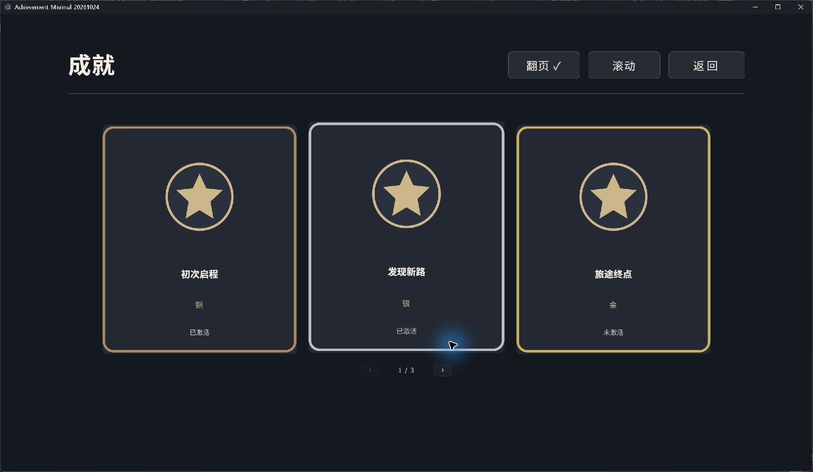
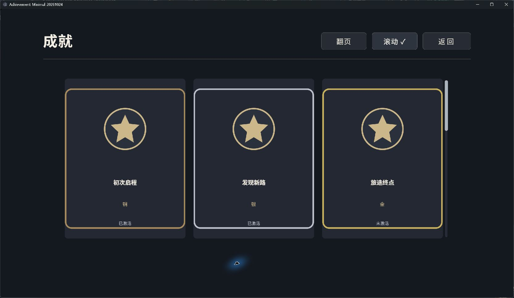

# 成就系统使用说明

版本 0.1.0。适用 LetsGal Studio 2.8.0-beta.1。

## 这个版本能做什么

| 功能 | 使用方式 |
| --- | --- |
| 等级 | 自己填写等级编号和名称；不填写时使用铜、银、金 |
| 成就定义 | 填写唯一编号、名称、图标和等级编号 |
| 状态 | 只有已激活、未激活 |
| 成就页 | 显示图标、名称、等级、状态；翻页、纵向滚动、横向滚动可固定使用或按需开放给玩家 |
| 自定义界面 | 编辑成就页、数据列表的内部卡片模板和浮现界面 |
| 浮现通知 | 首次激活后显示，连续激活依次排队，重复激活不重复显示 |

当前配置页保存定义到扩展设置，激活记录使用官方数据表。配置页自动写入官方作者表、自定义属性组及 Wiki 查阅备注尚未提供。鉴赏、进度、隐藏与揭晓阶段、分组系列、奖励助力和限时挑战不包含在此版本中。

## 安装和启用

1. 在 Studio 的个性化面板选择“导入扩展”，安装成品使用“复制导入”，持续开发使用“关联源码工程”。选择 mixing-entropy.achievement 文件夹。
2. 将“成就”加入当前项目并启用。
3. 在官方数据表面板找到“成就激活记录”依赖。缺少状态表时，使用扩展提供的模板创建并绑定，模板会设置为 profile（跨存档共享），含 achievementId（文本）、active（布尔）两列，初始表为空。
4. 已有旧测试表绑定时，先保留原表，再创建符合模板的 profile 表并改绑。更新扩展不会把旧表策略静默改掉；session 临时表不用于正式保存。
5. 在“成就配置”中添加成就。配置页中的校验提示需要无错误。

激活记录默认由同一玩家档案跨存档共享。读旧档、新开游戏不会回退已激活成就；执行“取消激活成就”会明确改变共享记录。跨设备同步、每组独立保存范围和自动数据迁移留待后续。

## 最小完整案例

1. 等级列表保持为空，使用默认金银铜。
2. 添加成就：编号 first_step，名称“初次启程”，等级编号 bronze；图标可选择项目图片，留空使用默认星形图标。
3. 在剧情中加入“调用扩展方法”，选择“成就 → 激活成就”，成就编号填写 first_step。
4. 再加入“成就 → 打开成就页”。运行后会出现浮现通知，成就页显示“已激活”。点击“返回”关闭成就页。
5. 再执行一次激活，状态保持已激活，不新增浮现。执行“取消激活成就”后显示未激活，再次激活会重新浮现。

下列成就页截图来自 Studio 2.8.0-beta.1 构建的独立桌面 Player，展示开启“允许玩家切换”后的页面；浮现截图来自同版 Studio 预览。示例名称只用于说明。

## 配置字段

| 字段 | 含义 |
| --- | --- |
| 等级编号 | 稳定唯一编号，例如 bronze；自定义编号可以用 master |
| 等级名称 | 玩家看见的等级名，例如“铜”或“大师” |
| 成就编号 | 稳定唯一身份，例如 first_step；改名时不要更换编号 |
| 成就名称 | 显示在成就页和通知中的文字 |
| 图标 | 项目图片；留空使用默认图标 |
| 成就的等级编号 | 必须对应已定义等级；使用默认等级时填写 bronze、silver 或 gold |
| 成就页 | 选择可视化 UI 文档，默认使用扩展自带成就页 |
| 页面浏览方式 | 固定翻页（默认）、固定纵向滚动、固定横向滚动、允许玩家切换 |
| 开放的浏览方式 | 允许玩家切换时分别勾选翻页、纵向滚动、横向滚动；至少保留一种 |
| 默认浏览方式 | 在已开放的方式中使用；玩家有效的已有选择优先 |
| 激活时浮现 | 控制后续新激活是否加入通知队列 |
| 浮现界面 | 选择可视化 UI 文档，默认使用扩展自带浮现界面 |
| 每条浮现时长 | 默认 3000 毫秒，允许 300 至 60000 毫秒 |

编号使用字母、数字、点、横线、下划线，以字母或数字开头，最长 128 字符。不同成就和不同等级分别要求编号唯一。自定义等级列表一旦非空便替代默认等级，因此需要把仍在使用的等级也列入。

## 方法块

| 方法 | 参数 | 结果 |
| --- | --- | --- |
| 激活成就 | 成就编号 | 未激活变为已激活；重复执行不重复通知 |
| 取消激活成就 | 成就编号 | 变为未激活，不播放达成通知 |
| 成就是否激活 | 成就编号 | 返回布尔值，可用于 If 条件 |
| 打开成就页 | 无 | 先刷新界面数据，再打开选定成就页 |
| 刷新成就界面数据 | 无 | 从定义与状态表重建显示数据 |

世界状态的监听、条件和宏可以调用这些官方方法块。成就模块不另设条件编辑器或时间调度器。读取不存在的成就会报错，避免把编号错误误判成未激活。快进或立即执行激活时只更新状态；存档恢复重放时不重复写入事实和通知。

## 自己设计 UI

在个性化的成就扩展下展开界面，编辑“成就页”。页面结构可自由修改；选中“成就列表”，进入其内部 card 模板，可修改单个成就的背景、边框、图标和文字。默认使用 5 列、2 行、间距 24 的分页布局，每页最多十张卡片；可以自行修改行列和间距。

在“成就配置 → 玩家界面 → 页面浏览方式”中，直接选择一种固定方式，或选择“允许玩家切换”并勾选要开放的方式。例如只勾选翻页、横向滚动，玩家就看不到纵向滚动按钮。固定方式或只勾选一种时，全部模式切换按钮隐藏，浏览操作仍可使用。配置页不能取消最后一种方式。

三种方式共用同一份卡片模板。列表的列数、行数和间距决定一屏如何编排：纵向先排满一行再向下延伸，横向先排满一列再向右延伸。横向支持鼠标滚轮、横向滚动输入和底部滚动条；列表获得键盘焦点后也可用左右键、Home、End。每张卡片内部的文字、图片、边框、按钮、数据绑定及高级 CSS 保留。

以下是同版 Studio 的真实配置页与固定模式预览。固定模式的页面没有模式切换按钮。

以下独立 Player 示例使用创作者修改过的双行卡片：新增“自由设计”文字、旋转图标及自定义底色，切换模式继续使用同一模板。

列表容器本身的高级 CSS 由浏览模块管理，卡片内部的高级 CSS 可自由编辑。将 achievement-list 保持为页面顶层的卡片列表，避免放进普通分组；当前 Studio 2.8 的分组内智能模板入口有限制。调整位置和大小直接操作列表即可。横向实现适配当前宿主的列表结构，升级宿主后应核对实际滚动；未知结构会在扩展日志提示，并保留纵向列表。

浏览选择保存在同一玩家档案的 browseMode 界面偏好中，与激活记录分开。固定方式不采用也不清除旧偏好；某种方式关闭后，旧选择暂不采用，重新开放后仍可恢复。自制页面保留数据列表标识符 achievement-list。需要玩家切换时添加相应按钮：achievement-mode-pagination（翻页）、achievement-mode-scroll（纵向）、achievement-mode-horizontal（横向）。控制器自动绑定点击，无须增加宏或剧情方法。按钮位置、外观可自行编排。通过“打开成就页”进入；修改作者设置后重开页面应用。

默认页面已包含三个可隐藏按钮；旧项目自制页若要开放横向切换，添加横向按钮即可，无需重做卡片模板。缺少 achievement-list 标识符时不接管页面；直接使用官方“显示界面”只展示作者原页面，不会应用本模块的模式选择和横向适配。

数据列表来源固定为 ext:mixing-entropy.achievement.entries。设置名称字段 name、说明字段 status、图片字段 icon。条目可用占位符：

| 占位符 | 内容 |
| --- | --- |
| {{item.title}} / {{item.name}} | 名称 |
| {{item.image}} / {{item.icon}} | 图标 |
| {{item.levelName}} | 等级名称 |
| {{item.status}} | 已激活或未激活 |
| {{item.active}} | 布尔激活状态 |
| {{item.id}} | 成就编号 |
| {{item.frame}} | 默认等级边框图片 |

金银铜按 bronze、silver、gold 编号给出不同边框，其他编号使用中性边框。可以移除边框图片或自行设计条目外观。entries 是只供界面显示的临时投影，不应手动写入；修改它不会改变真实激活记录。

使用另一张自制成就页时，在配置中选中该页，并通过“打开成就页”进入。若直接使用官方“显示界面”动作，则应先执行“刷新成就界面数据”；这种打开方式只展示页面，不绑定翻页／滚动切换按钮。当前界面选择项只支持可视化 UI 文档，不支持程序界面或系统槽位。

编辑“成就浮现”可以改变位置、大小、背景和进场退场动画。自制浮现页面保留下列控件标识符：achievement-name（名称文字）、achievement-level（等级文字）、achievement-icon（图片）；achievement-frame 可选，用于默认等级边框颜色。缺少某个标识符时，该控件不会自动填值。

通知不阻塞剧情点击。队列等待前一张界面关闭再显示下一张；游戏运行结束时清空队列并关闭正在播放的通知。浮现失败不会撤销已保存的激活记录。

## 数据、存档和更新

成就定义放在扩展结构化配置中，玩家激活事实由 states 数据表独立保存。世界状态负责调用时机，不保存第二份成就事实。

每条状态记录由宿主生成行 id，achievementId 对应成就编号，active 为布尔值。同一成就编号只允许一条记录。不要直接增删运行中的记录；通过方法块修改。

修改名称、图标和等级不会清除状态。暂时移除定义时保留旧记录，重新加入相同编号后可以继续读取原状态。更换编号相当于创建另一个成就；本版本不包含编号迁移工具。

已在 Studio 2.8.0-beta.1 生成的独立桌面 Player 中验证：先保存未激活时的槽位，再激活成就，读取旧槽位后仍保持激活；再次经过触发点不重复通知；正常退出后重新启动，从剧情开头也能看到已激活记录。Web/Android 和公开发行包导出尚未验收。

更新前保留项目与存档副本，导入新扩展后检查配置、数据表绑定及自定义 UI。此版本不包含复杂继承、跨周目重置和混合保存范围。不要将 profile 表改成 archive 或 session，否则会改变上述跨档保留规则。

## 常见问题

| 现象 | 处理 |
| --- | --- |
| 提示 states 未绑定 | 在数据表面板使用扩展模板创建并绑定 profile 表 |
| 提示等级不存在 | 检查等级编号；自定义列表会替代默认金银铜 |
| 修改名称后状态没了 | 检查是否同时改了稳定编号 |
| 不出现浮现 | 检查是否已激活、是否关闭通知、是否使用快进，以及浮现 UI 引用 |
| 自制页面没有内容 | 使用“打开成就页”，或先“刷新成就界面数据”；核对列表来源 |
| 界面提示无法打开 | 选择可视化文档，不选择程序界面或系统槽位 |
| 读旧档后成就丢失 | 核对绑定表是否为 profile；旧 session/archive 表不会自动迁移 |

## AI 指南辅助安装

运行 python tools/install-ai.py 默认只预览。在当前 Agent 有 letsgal-authoring 主技能时，配套知识安装到实际用户目录的 .letsgal-authoring/plugins/mixing-entropy.achievement/0.1.0；没有主技能时，才安装为独立 letsgal-plugin-achievement 技能。指定其它 Agent 可使用 --skills-root 与 --user-root。

确认预览目标后添加 --apply。相同内容重复执行不会覆盖；遇到同版本不同内容会停止并提示先比较保全。安装器不下载软件、不升级 Studio、不覆盖主技能。文件安装成功不等同于 Agent 已发现并使用技能。
